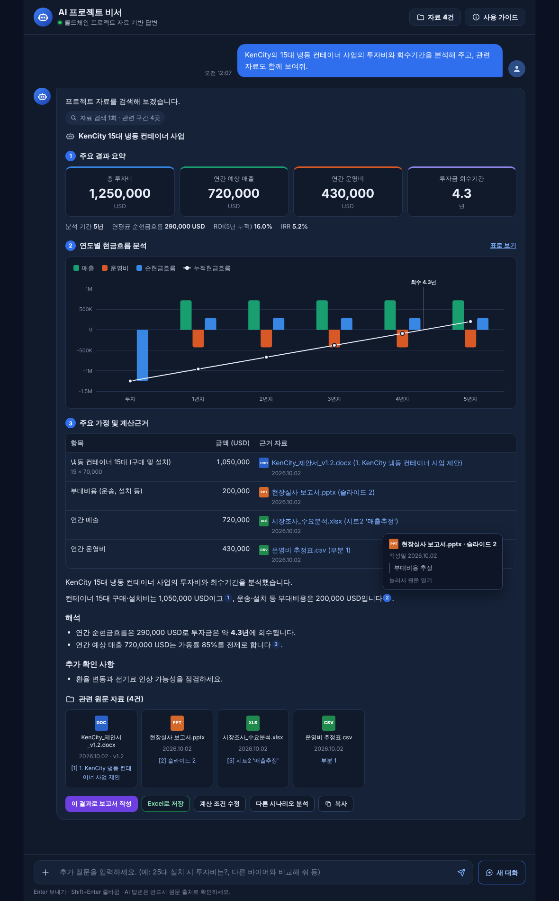

# AI 프로젝트 비서

프로젝트 자료(제안서·보고서·엑셀·회의록)를 올리면, Claude가 자료를 찾아 **출처와 함께** 답하고 투자비·회수기간을 **정확히 계산**해 주는 웹 앱입니다.
"가나 파트너 마켓 프로젝트" 화면 시안의 **메인 AI 대화 화면**을 실제로 동작하도록 만들었습니다.

> 이 폴더는 저장소의 기존 플레이북(`../index.html`)과 별개입니다. 기존 파일은 건드리지 않았습니다.


<sub>테스트용 가상 자료로 실행한 화면입니다.</sub>

## 할 수 있는 일

| 기능 | 내용 |
|---|---|
| 자연어 질문·답변 | 평소 말투로 질문하면 관련 자료를 검색해 답합니다. 후속 질문도 이어집니다. |
| 자료 검색·요약 | PDF·Excel·Word·PowerPoint·CSV·TXT를 올리면 쪽·시트·슬라이드 단위로 색인해 찾습니다. |
| 투자비·ROI 계산 | 총 투자비, 연도별 현금흐름, 회수기간, ROI, IRR(할인율을 주면 NPV)을 **계산 도구로** 구합니다. AI가 암산하지 않습니다. |
| 출처 표시·검증 | 답변 속 번호(¹)에 마우스를 올리면 근거 문장·파일·위치·작성일이, 누르면 원문(PDF는 해당 쪽)이 열립니다. |
| 결과 활용 | 요약 카드·현금흐름 차트·계산근거 표, **계산 조건 수정**(즉시 재계산), **Excel로 저장**(CSV), **이 결과로 보고서 작성** |
| 대화 저장 | 새로고침해도 대화가 이어지고, 자료는 팀원이 함께 씁니다. |

### 시안과 다른 점 — 회수기간 숫자를 바로잡았습니다
시안에는 총 투자비 1,250,000 USD, 연간 매출 720,000 USD, 연간 운영비 430,000 USD에 **회수기간 3.2**로 적혀 있지만,
연 순현금흐름은 720,000 − 430,000 = 290,000 USD이므로 1,250,000 ÷ 290,000 ≈ **4.3년**이 맞습니다.
앱은 "0년차에 투자, 1년차부터 운영 현금흐름 발생, 세전" 기준으로 계산하며 이 기준은 화면과 내려받은 파일에 함께 표시됩니다.

## 실행 방법

필요한 것: [Node.js](https://nodejs.org) 22.13 이상, [Claude API 키](https://console.anthropic.com)

```bash
cd ai-assistant
npm install
cp .env.example .env      # .env 파일을 열어 ANTHROPIC_API_KEY=sk-ant-... 입력
npm start
```

브라우저에서 <http://localhost:3000> 을 엽니다. 입력창 왼쪽 **+** 버튼(또는 화면에 끌어 놓기)으로 자료를 올리고 질문하세요.

### 팀원과 함께 쓰기
같은 네트워크의 팀원이 접속하게 하려면 `.env`에서 다음을 바꿉니다.

```
HOST=0.0.0.0
APP_PASSWORD=팀에서-정한-비밀번호
```

팀원은 `http://<이 컴퓨터의 IP>:3000` 으로 접속합니다(브라우저가 물으면 아이디는 아무거나, 비밀번호는 위 값).
인터넷에 공개하는 서버라면 반드시 `APP_PASSWORD`를 설정하고 HTTPS(리버스 프록시 등) 뒤에 두세요. 올린 자료는 접속한 모든 사람이 봅니다.

## 설정 (`.env`)

| 이름 | 기본값 | 설명 |
|---|---|---|
| `ANTHROPIC_API_KEY` | — | Claude API 키 (필수) |
| `PROJECT_NAME` | 콜드체인 프로젝트 | 화면에 표시할 프로젝트 이름 |
| `ASSISTANT_MODEL` | `claude-opus-5-5` | 사용할 Claude 모델 |
| `ASSISTANT_EFFORT` | `high` | 생각 깊이 `low`·`medium`·`high`·`xhigh`·`max` (높을수록 정확하지만 느리고 비쌈) |
| `HOST` / `PORT` | `127.0.0.1` / `3000` | 서버 주소 |
| `APP_PASSWORD` | (없음) | 설정하면 접속 시 비밀번호를 묻습니다 |
| `DATA_DIR` | `data` | 자료·대화 저장 폴더 |
| `MAX_UPLOAD_MB` | `50` | 파일당 최대 크기 |

## 알아 둘 점

- **지원 형식**: `.pdf` `.xlsx` `.xlsm` `.docx` `.pptx` `.csv` `.txt` `.md`. 예전 형식(`.xls` `.doc` `.ppt`)과 `.hwp`는 새 형식이나 PDF로 저장해 올려 주세요.
- **스캔한 PDF**(이미지만 있는 PDF)는 글자를 읽지 못합니다. 업로드할 때 경고가 표시됩니다.
- **같은 이름의 파일**을 다시 올리면 두 버전이 모두 검색됩니다. 이전 버전은 **자료** 창에서 삭제하세요.
- **비용**: 질문마다 Claude API 요금이 듭니다(Claude Opus 5.5 기준 입력 100만 토큰당 $4, 출력 $20). 같은 대화 안의 반복 내용은 프롬프트 캐시로 할인됩니다. 서버 콘솔에 요청별 토큰 사용량이 찍힙니다.
- **안전 정책 대응**: 드물게 안전 분류기가 요청을 거절하면 서버에서 자동으로 다른 Claude 모델로 다시 처리합니다(`fallbacks: "default"`). 필요 없으면 `server/assistant.js`에서 해당 줄을 지우세요.
- **저장 위치**: 올린 원본·추출 텍스트·대화는 `data/` 폴더에 있습니다. 백업은 이 폴더를 복사하면 됩니다.
- **계산 조건 수정**은 화면에서만 다시 계산합니다. AI에게 해석을 받으려면 "다시 계산하고 AI 해석 요청"을 누르세요.

## 구조

```
ai-assistant/
├─ server/
│  ├─ index.js       웹 서버와 API (자료 업로드·삭제, 대화, 답변 스트리밍)
│  ├─ assistant.js   Claude 호출 반복(검색 → 계산 → 답변), 시스템 프롬프트
│  ├─ tools.js       Claude가 쓰는 도구: search_documents, read_document, calculate_investment
│  ├─ parsers.js     PDF·Excel·Word·PowerPoint·CSV 텍스트 추출
│  ├─ search.js      한국어 두 글자 단위 BM25 검색
│  ├─ store.js       data/ 폴더 저장
│  └─ config.js      .env 설정
├─ public/
│  ├─ index.html · app.css · app.js   대화 화면
│  ├─ analysis.js    요약 카드, 현금흐름 차트, 계산근거 표, CSV 저장, 조건 수정
│  └─ shared/finance.js  투자비·현금흐름 계산 (서버와 화면이 같은 코드 사용)
└─ test/             자동 테스트 (실제 API 키 없이 가짜 Claude API로 실행)
```

### 답변이 만들어지는 과정
1. 질문과 함께 업로드 자료 목록을 Claude에 보냅니다.
2. Claude가 `search_documents`로 자료를 찾습니다. 결과는 `search_result` 블록(파일명·위치 포함)으로 돌려줘서, Claude가 문장마다 **인용(citation)** 을 달 수 있습니다.
3. 수익성 계산이 필요하면 Claude가 근거 출처를 붙여 `calculate_investment`를 호출하고, 서버가 정확히 계산해 화면에 카드·차트·표로 보여 줍니다.
4. 답변은 글자 단위로 실시간 표시되고, 인용은 번호와 "관련 원문 자료" 카드로 정리됩니다.

## 테스트

```bash
npm test
```

실제 API 키 없이, 같은 형식의 스트림을 보내는 가짜 Claude API(`test/fake-anthropic.js`)로 업로드 → 검색 → 계산 → 출처가 달린 답변까지 전체 흐름을 확인합니다.
